# Conditional Knowledge Retrieval: Implementation Workflow & Architecture

**Primary Reference:** `C:\dev\conditional context retrieval.md` (Doc 02 §6–§13, Doc 01 §10 & §13, Doc 06)  
**Component:** `[ CONDITIONAL KNOWLEDGE RETRIEVAL: ONLY WHEN NEEDED ]`  
**Status:** Phases 1–6 Fully Implemented, Hardened & Verified. 14/14 End-to-End Acceptance Tests Green in a Single CI Suite.

---

## 1. Executive Summary & Core Principle

In PitchProX, conversational strategy is strictly governed by the Core Intelligence engine. External knowledge retrieval never dictates strategy, never overrides live conversation truth, and never executes simply because a conversational turn occurs.

> **The Golden Law:**  
> **The Core decides the strategy. Retrieval supplies facts. The LLM verbalizes.**  
> If no verified, user-owned knowledge exists, the system does **not** fail or fabricate claims; it continues truthfully using zero-assumption conversational language or a clarifying question.

### Core Architectural Axioms
1. **Conditional by Design:** Retrieval executes *only* when a specific knowledge trigger is raised and active user documents exist. "None found" or "none needed" is a normal, healthy system outcome.
2. **Strict Individual-User Isolation (Constraint C6):** Knowledge belongs exclusively to individual reps (`owner_scope == 'user'`, `owner_user_id == current_user`). There is zero team, brokerage, or cross-tenant sharing. User A can never search, view, or cache User B's documents.
3. **Eventual Consistency Defense:** Candidate chunks returned from external vector stores (e.g., Pinecone) are always re-verified in real-time against the authoritative document store before ranking or packaging.
4. **Dual Stale-Result Discard:** Conversation state is versioned (`state_version`). If a prospect interrupts while retrieval is executing *or* while the LLM is generating, the stale result/prompt is discarded immediately before reaching the agent's teleprompter.
5. **Zero Invented Facts:** No numbers, transaction counts, dollar figures, percentages, awards, or guarantees may be uttered unless grounded in Block 3 verified facts or explicitly spoken by the prospect in Block 2.

---

## 2. End-to-End Architectural Workflow

```mermaid
flowchart TD
    A[Core Strategic Decision: StrategicDecision] --> B{Step 1: Retrieval Gate}
    B -- No Trigger / Wait Action / Zero Docs --> C[Fast Short-Circuit: none_needed / none_found]
    C --> D[Truthful Spoken Fallback / Alternate Move]
    
    B -- Trigger Flagged & In-Scope Docs Exist --> E[Step 2: Targeted Query Builder & Embeddings]
    E --> F[Step 3: Vector Store In-Query Hard Pre-Filters]
    
    subgraph PreFilters [Constraint C6 & Hard Pre-Filters]
        F1[owner_scope == 'user' AND owner_user_id == user_id]
        F2[Exclude deleted == True / Tombstone]
        F3[Exclude superseded_by != None]
        F4[Validity Window: effective_from / to]
        F5[Sensitivity: Exclude restricted; gate confidential]
        F6[Lead-Type Tag Match]
    end
    F --> PreFilters
    PreFilters --> G[Step 4: Vector Search Top-K Candidates]
    
    G --> H{Step 5: Authoritative Store Re-Verification}
    subgraph AuthoritativeRecheck [Eventual Consistency Defense]
        H1[Re-check deleted in authoritative store]
        H2[Re-check superseded_by in authoritative store]
        H3[Re-verify SHA-256 Attestation Hash]
    end
    H --> AuthoritativeRecheck
    AuthoritativeRecheck --> I[Step 6: Multi-Factor Ranking & Relevance Floors]
    
    I -- Top Score < Floor 0.35 --> J[Status: none_found]
    I -- Floor 0.35 <= Top Score < 0.50 --> K[Status: low_confidence]
    I -- Top Score >= 0.50 --> L[Status: retrieved]
    
    J & K & L --> M[Step 7: General Contradiction & Safety Table]
    
    subgraph ConflictResolution [Doc 02 §8 Conflict Hierarchy]
        M1[Two User Docs Disagree: Safe Default Withhold]
        M2[Compliance / Safety Wins: Fair Housing & RESPA]
        M3[Live Conversation Truth Wins Over Stored Script]
        M4[Playbook Move Retained with Substituted Policy]
        M5[Attestation Integrity: SHA-256 Validated]
    end
    M --> ConflictResolution
    ConflictResolution --> N[Step 8: Retrieval Packaging & Latency Metrics Aggregation]
    
    N --> O{Step 9: First Stale Check: retrieval.state_version == snapshot.state_version}
    O -- Stale != --> P[Discard Facts -> status=stale_discarded]
    O -- Match == --> Q[Step 10: 6-Block Prompt Assembly]
    
    subgraph ContextBlocks [Spec 11 §7 Context Contract]
        Q1[Block 1: Strategic Decision Contract]
        Q2[Block 2: Current Conversation Truth & Recent Turns]
        Q3[Block 3: Untrusted Reference Data + Delimiter Escape]
        Q4[Block 4: Playbook Methodology Constraints]
        Q5[Block 5: Calibration Delivery Constraints]
        Q6[Block 6: Mandatory Directives + Fact-Absence Guard]
    end
    Q --> ContextBlocks
    ContextBlocks --> R[Step 11: LLM Prompt Generation]
    R --> S{Step 12: Second Stale Check: post_gen_state_version == prompt.state_version}
    S -- Interrupted != --> T[Discard Prompt -> status=stale_discarded]
    S -- Current == --> U[Step 13: Post-Generation Hallucination Scanner]
    U --> V[Verified Spoken Teleprompter Prompt]
```

---

## 3. Step-by-Step Implementation Breakdown

### Step 1: Interface Contracts & Data Schemas
- **Location:** [`copilot/conditional_retrieval_models.py`](file:///c:/dev/Sales_Ai/copilot/conditional_retrieval_models.py)
- **Implemented:**
  - `RetrievalRequest`: Upstream contract carrying `request_id`, `call_id`, `state_version`, `user_id`, `lead_type`, `prospect_type`, `strategic_action`, `retrieval_need`, `conversation_evidence`, and `deadline_ms`.
  - `RetrievalNeed`: Structure encapsulating trigger type, `need_statement`, `topic_tags`, and `time_sensitive` flag.
  - `RetrievedFact`: Downstream contract carrying `knowledge_id`, verified `text`, `knowledge_class`, `verification_status`, `source_title`, `source_version`, `confidence`, and `authority_level` (Level 3: Company Approved / System Validated, Level 2: Self-Attested, Level 1: User Supplied).
  - `WithheldFact`: Audit structure logging withheld chunk IDs with reasons (`"disputed"`, `"stale"`, `"unverified"`, `"restricted"`).
  - `RetrievalResult`: Standard result envelope with `state_version`, `status` (`retrieved`, `none_needed`, `none_found`, `low_confidence`, `conflict_unresolved`, `timed_out`, `stale_discarded`, `error`), `facts`, `withheld`, `fallback_hint`, `latency_ms`, and `stage_latencies`.
  - `KnowledgeRecord`: Data model strictly enforcing Constraint C6 via Pydantic model validator: `owner_scope` must be `'user'` and `owner_user_id` is mandatory. Ingestion strictly rejects `team`, `brokerage`, and `company` scopes with `ValueError`.

---

### Step 2: The Retrieval Gate (Doc 02 §6)
- **Location:** [`copilot/conditional_retrieval.py`](file:///c:/dev/Sales_Ai/copilot/conditional_retrieval.py) (`RetrievalGate`)
- **Implemented:**
  - Evaluates whether vector search should execute based on deterministic rules:
    1. **Rule 1 (No Trigger):** If `retrieval_need` or trigger is absent $\rightarrow$ returns `status="none_needed"`, fast exit (0ms).
    2. **Rule 2 (Excluded Action):** If `strategic_action` in `{"wait_silence", "wait", "hold", "acknowledge"}` $\rightarrow$ returns `status="none_needed"` (no facts required for listening or acknowledging).
    3. **Rule 3 (Zero Knowledge):** If the user has 0 active, in-scope knowledge documents $\rightarrow$ returns `status="none_found"`, bypassing expensive vector embedding and search.
    4. **Rule 4 (Proceed):** Valid trigger and active knowledge $\rightarrow$ proceeds to Query Builder.
  - **Six Canonical Triggers:** `factual_question`, `credibility_objection`, `service_process_objection`, `playbook_evidence`, `policy_wording`, `prior_claim_reference`.
  - **Fallback Hint Resolution:**
    - Social Proof / Playbook Evidence $\rightarrow$ `"choose_alternate_move"` (Core picks alternate move; never fabricates proof).
    - Factual questions / Prior claims $\rightarrow$ `"ask_clarifying_question"` (Truthfully clarify with prospect).
    - Policy / Objections $\rightarrow$ `"use_generic_truthful"` (Use truthful conversational language without stored facts).
  - **Observability:** Logs every decision to `GateDecisionLog` with timestamp, request ID, state version, user ID, strategic action, trigger, and exact decision reason.

---

### Step 3: Targeted Query Builder & Embeddings
- **Location:** [`copilot/conditional_retrieval.py`](file:///c:/dev/Sales_Ai/copilot/conditional_retrieval.py) (`QueryBuilder`)
- **Implemented:**
  - Builds targeted search text from `need_statement` + `topic_tags` + trimmed `conversation_evidence` (never dumps whole transcript).
  - Shortlists target knowledge classes based on the trigger (e.g. `credibility_objection` shortlists `salesperson_profile`, `performance_past_sales`, and `value_proposition`).
  - Configures pinned embedding model (`EMBEDDING_MODEL = text-embedding-3-small`, dimension `1536`).

---

### Step 4: Strict In-Query Hard Pre-Filters (Constraint C6)
- **Location:** [`copilot/conditional_retrieval.py`](file:///c:/dev/Sales_Ai/copilot/conditional_retrieval.py) (`KnowledgeStore.search_candidates`), [`copilot/rag_pinecone.py`](file:///c:/dev/Sales_Ai/copilot/rag_pinecone.py)
- **Implemented in the vector query itself (not post-retrieval application code):**
  1. **Ownership Filter:** `owner_scope == 'user'` AND `owner_user_id == request.user_id`. Chunks belonging to other users are never seen, searched, or loaded.
  2. **Tombstone Deletion:** Excludes chunks where `deleted == True`.
  3. **Supersession Filter:** Excludes chunks where `superseded_by is not None` (retained in store for audit history only).
  4. **Validity Window:** Excludes chunks where `now < effective_from` or `now > effective_to`.
  5. **Sensitivity Filter:** `restricted` chunks are permanently withheld from context; `confidential` chunks are excluded unless `allow_confidential=True`.
  6. **Lead-Type Constraints:** If a chunk explicitly tags supported lead types (e.g. `['investor']`), it is excluded when querying for mismatched lead types (e.g. `'first_time_buyer'`).

---

### Step 5: Multi-Factor Candidate Ranking & Calibrated Relevance Floors
- **Location:** [`copilot/conditional_retrieval.py`](file:///c:/dev/Sales_Ai/copilot/conditional_retrieval.py), [`tests/test_threshold_calibration.py`](file:///c:/dev/Sales_Ai/tests/test_threshold_calibration.py)
- **Implemented:**
  - Tunable `RankingWeights`:
    - `semantic_weight = 0.50` (Cosine / token similarity)
    - `lead_type_boost = 0.15` (Matching lead-type tags)
    - `prospect_type_boost = 0.10` (Matching prospect-type tags)
    - `verification_boost = 0.15` (Company approved / system validated boost)
    - `specificity_boost = 0.10` (Topic tag overlap)
    - `recency_boost = 0.10` (Applied only when `time_sensitive = True`)
    - `conflict_penalty = 0.30` (Applied when chunks contradict newer documents)
  - **Calibrated Relevance Floors:**
    - `relevance_floor = 0.35`: Candidates below 0.35 raw semantic similarity are dropped even if they are the #1 candidate. If none clear 0.35 $\rightarrow$ `status="none_found"`.
    - `marginal_threshold = 0.50`: If top raw similarity is between 0.35 and 0.50 $\rightarrow$ `status="low_confidence"`, triggering clarifying question or generic truthful fallback.
    - Capped at `max_facts = 3` (concise precision over document dumping).

---

### Step 6: Post-Search Authoritative Store Re-Verification (Eventual Consistency Defense)
- **Location:** [`copilot/conditional_retrieval.py`](file:///c:/dev/Sales_Ai/copilot/conditional_retrieval.py) (`_recheck_candidates_against_authoritative_store`)
- **Implemented:**
  - Defends against remote vector DB propagation lag (where deleted or superseded vectors remain searchable for several seconds).
  - Re-fetches the authoritative record from `store.get_record(kid)` for each search candidate:
    1. If `auth_rec.deleted == True` $\rightarrow$ dropped immediately as stale.
    2. If `auth_rec.superseded_by` is set $\rightarrow$ dropped immediately.
    3. If `auth_rec.verification_status == "self_attested"`: verifies the SHA-256 hash of the chunk text against `auth_rec.attestation_metadata.attestation_hash`. If tampered with, demotes the record to `user_supplied`, clears attestation metadata, and withholds the chunk with `reason="unverified"`.

---

### Step 7: General Contradiction Detection & Safety Hierarchy (Doc 02 §8)
- **Location:** [`copilot/conditional_retrieval.py`](file:///c:/dev/Sales_Ai/copilot/conditional_retrieval.py) (`_resolve_candidate_conflicts`, `_detect_contradiction`)
- **Implemented:**
  1. **Safe Default-Withhold:** If two user documents disagree on key quantitative metrics (`%`, `$`), opposing antonyms (`free` vs `fee`, `allowed` vs `prohibited`, `mandatory` vs `optional`), or direct negation polarity on substantive shared tokens, and neither explicitly supersedes the other, **both chunks are withheld** with `reason="disputed"`, yielding `status="conflict_unresolved"`.
  2. **Compliance / Safety Wins:** Uploads conflicting with fair housing or RESPA safety rules are withheld with `reason="restricted"`.
  3. **Live State Over Stored Knowledge:** Prospect's live stated facts override contrary stored assumptions.
  4. **Playbook Method vs. Company Policy:** Retains Playbook strategy/conversational move (e.g. objection reframe) while substituting company-approved factual terms, tagging chunk with `playbook_strategy_retained=True`.
  5. **Unverified Performance Claims:** Chunks claiming closed transactions, sales volume, or awards lack verification $\rightarrow$ withheld with `reason="unverified"`.

---

### Step 8: Hallucination Guardrails & Hybrid Attestation
- **Locations:** [`copilot/compliance_rules.py`](file:///c:/dev/Sales_Ai/copilot/compliance_rules.py), [`copilot/llm_response_gateway.py`](file:///c:/dev/Sales_Ai/copilot/llm_response_gateway.py)
- **Implemented:**
  - **Prohibited Claim Types:** System-wide prohibition against inventing transaction volumes, credentials, statistics, customer outcomes, case studies, conversion rates, guarantees, certifications, or legal claims.
  - **Hybrid Attestation Model:** Reps can self-attest personal experience (tenure, territory, closed homes).
    - Requires ownership check: `user_id == rec.owner_user_id`.
    - Enforces SHA-256 hash verification: text edits or re-ingestions immediately break the hash and revert status to `user_supplied`.
    - Fail-closed classification: ambiguous or high-risk claims (guarantees, awards, stats) fail closed and are rejected from attestation.
  - **Post-Generation Validator (`validate_prompt_hallucinations`):**
    - Scans generated prompts for ungrounded numbers, percentages, dollar figures, and guarantees.
    - Exempts numbers and figures stated by the prospect in conversation truth.
    - Enforces exact-figure edge cases (handles `50` $\leftrightarrow$ `fifty`, `10 years` $\leftrightarrow$ `a decade`).
    - Strictly rejects upward escalations (`50+`, `over 50`, `more than 50`).
    - Configurable approximation policy (`allow_attested_approximation=False` by default).

---

### Step 9: Structured 6-Block Context Packaging & Prompt Assembly
- **Location:** [`copilot/llm_response_gateway.py`](file:///c:/dev/Sales_Ai/copilot/llm_response_gateway.py) (`assemble_context`, `generate_prompt`)
- **Implemented:**
  - **Block 1: Strategic Decision Contract:** Primary action, secondary action, strategic objective, push strength, reason codes, prohibited actions (`do_not_do`), what to protect, question allowed.
  - **Block 2: Current Conversation Truth:** Active objections with lifecycle state, decision maker presence, state version, last 3 transcript turns.
  - **Block 3: Verified Knowledge:**
    - Untrusted reference data wrapper: `[UNTRUSTED_REFERENCE_DATA_START]` ... `[UNTRUSTED_REFERENCE_DATA_END]`.
    - Delimiter breakout protection: Escapes any nested `[UNTRUSTED_REFERENCE_DATA_END]` in chunk texts to `\[UNTRUSTED_REFERENCE_DATA_END\]`.
    - Clear distinction between `[SELF_ATTESTED_REP_CLAIM]` (Authority 2, first-person only), `[POLICY_SUBSTITUTED_INTO_PLAYBOOK_STRATEGY]` (Authority 3), and standard company-approved facts.
  - **Block 4: Playbook Constraints:** Methodology constraints and playbook IDs.
  - **Block 5: Calibration Delivery Constraints:** Maximum prompt words, urgency, spoken conversational mode.
  - **Block 6: Mandatory Generation Directives:**
    - Priority hierarchy strictly encoded (Doc 01 §10): Priority 1 Safety $\rightarrow$ Priority 2 Core Intent $\rightarrow$ Priority 3 Live Conversation Truth $\rightarrow$ Priority 4 Playbook Methodology $\rightarrow$ Priority 5 Retrieved Facts $\rightarrow$ Priority 6 Calibration $\rightarrow$ Priority 7 Polish.
    - Fact-Unavailability Guard: When evidence is missing, commands zero fabrication of numbers or client outcomes.
    - Self-Attested Claim Rule: Enforces first-person phrasing (*"In my experience..."*), forbidding brokerage-wide or third-party phrasing.

---

### Step 10: Multi-Instance Cache Versioning & Dual Stale Discards
- **Location:** [`copilot/conditional_retrieval.py`](file:///c:/dev/Sales_Ai/copilot/conditional_retrieval.py), [`copilot/llm_response_gateway.py`](file:///c:/dev/Sales_Ai/copilot/llm_response_gateway.py)
- **Implemented:**
  - **Cache Versioning:** `KnowledgeStore` maintains `_user_knowledge_versions[user_id]`. Cache keys embed this version: `user_id:v{user_knowledge_version}:state_version:...`. Mutating operations (add, delete, replace, attest) bump this integer version, instantaneously invalidating cache across all running instances.
  - **Dual Stale-Result Checkpoints (`!=` Operator):**
    1. *Checkpoint 1 (Retrieval Exit):* In `ConditionalRetrievalEngine.validate_or_discard_stale_result`, if `result.state_version != current_state_version`, facts are discarded and status is set to `stale_discarded`.
    2. *Checkpoint 2 (LLM Generation Exit):* In `LLMResponseGateway.generate_prompt`, if `post_generation_state_version != decision.source_state_version`, the generated prompt is marked `stale_discarded` before teleprompter delivery.
  - **Legacy Path Fail-Closed:** `retrieve_for_decision` fails closed immediately with an empty result if `user_id` is missing or None.

---

### Step 11: Production Vector Store Wiring & Migration
- **Location:** [`copilot/rag_pinecone.py`](file:///c:/dev/Sales_Ai/copilot/rag_pinecone.py)
- **Implemented:**
  - **Metadata Alignment:** Ingestion writes both pairs of metadata keys: `owner_id` and `owner_user_id`, as well as `scope` and `owner_scope`.
  - **Strict Ownership Query Filter:** Pinecone searches enforce `$and: [{"owner_user_id": user_id}, {"owner_scope": "user"}]`.
  - **Unmigrated Vector Exclusion:** Chunks missing owner metadata are excluded on read.
  - **Migration Utility:** `migrate_metadata_keys(tenant_id)` inspects existing vectors and backfills dual keys.
  - **Network Call Timeouts:** Embedding generation and Pinecone network requests are bounded by explicit per-call timeouts (50ms embedding timeout, 100ms vector search timeout).

---

### Step 12: Latency Instrumentation & Statistical Aggregation
- **Location:** [`copilot/conditional_retrieval.py`](file:///c:/dev/Sales_Ai/copilot/conditional_retrieval.py) (`LatencyMetricsAggregator`, `StageLatencies`)
- **Implemented:**
  - Tracks granular per-stage latencies: `gate_ms`, `embedding_ms`, `search_ms`, `ranking_conflict_ms`, `packaging_ms`, `total_ms`.
  - `LatencyMetricsAggregator` records calls across all pipeline executions:
    - Computes p50, p95, and p99 percentiles for every stage and total duration.
    - Monitors deadline hit rate: triggers warning/error logging if deadline hits exceed 5% of requests.

---

## 4. The 10 Developer Work Hardening Items (Audit & Status)

All 10 required developer items are fully implemented and verified in code:

| # | Item | Status | Verification & Implementation Detail |
|---|---|---|---|
| **1** | **Acceptance suite (Phase 6)** | **DONE** | 14 end-to-end scenarios run in ONE CI file: `tests/test_conditional_retrieval_acceptance_suite.py`. Verifies final assembled prompt and context, not just internal state. |
| **2** | **Production Pinecone wiring** | **DONE** | In `copilot/rag_pinecone.py`, writes both `owner_id` & `owner_user_id`, `scope` & `owner_scope`. Excludes unmigrated vectors. Added `migrate_metadata_keys`. |
| **3** | **Threshold calibration** | **DONE** | Calibrated 0.35 floor and 0.50 marginal threshold against real queries in `tests/test_threshold_calibration.py`. All 4 tests pass. |
| **4** | **Authoritative store re-check** | **DONE** | `_recheck_candidates_against_authoritative_store` verifies `deleted`, `superseded_by`, and SHA-256 hash against `store.get_record()` to defend against eventual consistency lag. |
| **5** | **Multi-instance cache versioning** | **DONE** | Added `user_knowledge_version` to cache key (`user_id:v{kv}:...`) and store mutation methods. Invalidates across multiple instances simultaneously. |
| **6** | **Hard timeouts on network calls** | **DONE** | Network calls in `rag_pinecone.py` and `conditional_retrieval.py` use per-call client timeouts (50ms embeddings, 100ms Pinecone search) preventing hung requests. |
| **7** | **General contradiction detection** | **DONE** | `_detect_contradiction` detects metric differences (`%`, `$`), opposing antonym pairs, and polarity negation conflicts. Default-withholds both docs unless explicitly superseded. |
| **8** | **Live pipeline dual stale discard** | **DONE** | Version checks use `!=` (handling any advance or divergence). Checked at retrieval exit and post-generation exit in `LLMResponseGateway.generate_prompt`. |
| **9** | **Legacy path deprecation** | **DONE** | `retrieve_for_decision` in `conditional_retrieval.py` fails closed immediately if `active_user` resolves to empty/None. |
| **10** | **Latency metrics aggregation** | **DONE** | Implemented `LatencyMetricsAggregator` tracking p50/p95/p99 for all stages and logging alerts if deadline breaches exceed 5%. |

---

## 5. Phase 6: The 14 Acceptance Scenarios (Doc 02 §13 & Workflow)

All 14 acceptance scenarios are automated in `tests/test_conditional_retrieval_acceptance_suite.py` and run end-to-end checking the final assembled context and generated prompt:

| # | Scenario Name | Test Function | Pass Criteria (End-to-End Prompt & Context) | CI Status |
|---|---|---|---|---|
| **1** | **No upload** (Doc 02 §13) | `test_scenario_1_no_upload_end_to_end` | Gate yields `none_found`. Block 3 contains no verified facts; Block 6 commands zero fabricated claims; generated prompt contains no invented numbers. | **PASS** |
| **2** | **Relevant upload** (Doc 02 §13) | `test_scenario_2_relevant_upload_end_to_end` | Prospect asks about local sales; Block 3 wraps chunk in untrusted reference data; prompt accurately uses verified fact (42 homes) without extra claims. | **PASS** |
| **3** | **Irrelevant upload** (Doc 02 §13) | `test_scenario_3_irrelevant_upload_end_to_end` | Unrelated warehouse zoning chunk is dropped; Block 3 has zero facts; context text matches no-upload case. | **PASS** |
| **4** | **Contradictory upload** (Doc 02 §13) | `test_scenario_4_contradictory_upload_end_to_end` | Two conflicting docs (5% vs 6% commission); newer approved version wins; disputed chunk withheld; prompt asserts 5% only. | **PASS** |
| **5** | **Deleted upload** (Doc 02 §13) | `test_scenario_5_deleted_upload_end_to_end` | Chunk tombstoned (`deleted=True`); vector search & authoritative re-check exclude it; Block 3 contains no facts. | **PASS** |
| **6** | **Cross-user leakage** (Doc 02 §13) | `test_scenario_6_cross_user_leakage_end_to_end` | User A's chunk is never retrieved or cached for User B even within same brokerage/call; Block 3 has zero facts for User B. | **PASS** |
| **7** | **Historical marketing claim** (Doc 02 §13) | `test_scenario_7_historical_marketing_claim_end_to_end` | Legacy pitch deck claims (#1 producer, 7-day guarantee) are user_supplied/unapproved; withheld as unverified; omitted from context. | **PASS** |
| **8** | **No-trigger turn** (Workflow) | `test_scenario_8_no_trigger_turn_end_to_end` | Turn with no trigger flagged -> Gate short-circuits (`none_needed`); 0 vector calls executed; prompt generated cleanly without facts. | **PASS** |
| **9** | **Script doesn't override Core** (Workflow) | `test_scenario_9_script_does_not_override_core_end_to_end` | Retrieved aggressive script cannot alter Core's strategic decision (DISCOVERY / EDUCATE retained; hard-close rejected). | **PASS** |
| **10** | **Social Proof with no proof** (Workflow) | `test_scenario_10_social_proof_with_no_proof_end_to_end` | Rep has no uploaded testimonials; Gate returns `choose_alternate_move`; Block 6 commands zero fabricated proof; Core pivots move. | **PASS** |
| **11** | **Stale result** (Workflow) | `test_scenario_11_stale_result_end_to_end` | Prospect interrupts mid-retrieval ($V_{req} \neq V_{curr}$); result marked `stale_discarded`; Block 3 shows `[STALE_DISCARDED]`; prompt addresses latest turn. | **PASS** |
| **12** | **Timeout** (Workflow) | `test_scenario_12_timeout_end_to_end` | Slow retrieval exceeds deadline budget; returns `timed_out`; Block 3 shows `[TIMED_OUT]`; prompt delivered on time with truthful fallback. | **PASS** |
| **13** | **Live truth over stored fact** (Workflow) | `test_scenario_13_live_truth_over_stored_fact_end_to_end` | Stored consultation hours (morning) conflict with prospect's live statement ("afternoon at 3:00 PM"); stored chunk withheld; live truth wins in prompt. | **PASS** |
| **14** | **Team scope rejection** (Constraint C6) | `test_scenario_14_team_scope_rejection_end_to_end` | Ingestion rejects `owner_scope="team"` with `ValueError`; read queries with team scope fail; zero cross-agent leakage. | **PASS** |

---

## 6. Client Decisions Still Needed

The following 6 strategic and policy items require client alignment:

| # | Client Decision Item | Context & Engineering Recommendation | Impact / Action Required |
|---|---|---|---|
| **1** | **Latency Target & Budget** | Current engine budget is set to **250ms** max per retrieval turn (Gate: 10ms, Embedding: 50ms, Vector search: 100ms, Conflict resolution: 40ms, Packaging: 50ms). | Client to confirm if total conversational SLA permits 250ms or requires sub-200ms. |
| **2** | **Deletion Propagation Window** | Pinecone vector index deletions are eventually consistent (~2–5s lag). Our authoritative store re-check catches deletions at 0ms. | Client to confirm that 0ms authoritative re-check satisfies SLA, or if synchronous vector index flush is required. |
| **3** | **Pipeline Order Confirmation** | Confirmation that Core Intelligence *always* determines the strategic action before retrieval executes, and that retrieval can never alter the action. | Client sign-off on unidirectional Core $\rightarrow$ Retrieval pipeline flow. |
| **4** | **Prospect Facts Boundary (Prospect Memory)** | Facts about the prospect (company size, pain points, timeline) belong in **Prospect Memory** (Block 2), whereas Knowledge Retrieval handles user/company facts (track record, pricing, policies). | Client confirmation of architectural boundary separating Prospect Memory from Knowledge Retrieval. |
| **5** | **Compliance Reviewer Sign-Off** | Regex filters in `compliance_rules.py` enforce Fair Housing (protected classes) and RESPA (kickbacks, fee-splitting) safety checks. | Client compliance officer formal sign-off on the keyword lists. |
| **6** | **Approximate Phrasing Policy** | Current policy is strict: an attested claim of *"closed 50 homes"* cannot be escalated or softened into *"about 50 homes"* or *"50+ homes"*. | Client to decide whether to allow conversational approximation ("about 50") or keep strict exact-figure guardrails (`allow_attested_approximation=False`). |

---

## 7. Pre-Launch Constraints Verification Checklist

Before deploying conditional retrieval to production staging, the engineering team must re-verify the following core constraints:

- [x] **Constraint C6 (Individual-User Ownership Only):**
  - Ingestion strictly validates `owner_scope == 'user'` and non-empty `owner_user_id`.
  - In-query filters explicitly bind `owner_user_id == current_user`.
  - Cache partition keys strictly incorporate `user_id`.
  - No team, brokerage, or organizational scopes exist.
- [x] **Conditional Retrieval (Strictly When Needed):**
  - Gate short-circuits turns with no trigger (`none_needed`).
  - Gate short-circuits listening/acknowledgment actions (`none_needed`).
  - Zero-doc users trigger 0ms fast exit (`none_found`), bypassing vector search.
- [x] **Zero Invented Facts:**
  - Block 6 enforces strict Fact-Unavailability directives when evidence is missing.
  - Post-generation scanner flags ungrounded numbers, percentages, dollar figures, and guarantees.
  - Attested claims enforce first-person phrasing and SHA-256 hash integrity.
- [x] **Dual Stale Discard:**
  - Retrieval result checked against `state_version` upon return.
  - LLM response checked against `state_version` before teleprompter delivery.
- [x] **Authoritative Eventual Consistency Defense:**
  - Candidates from vector DB re-verified against authoritative store `deleted`, `superseded_by`, and attestation hash.

---

## 8. Key Files & Test Reference Map

- **Data Models:** [`copilot/conditional_retrieval_models.py`](file:///c:/dev/Sales_Ai/copilot/conditional_retrieval_models.py)
- **Engine, Gate, Store & Cache:** [`copilot/conditional_retrieval.py`](file:///c:/dev/Sales_Ai/copilot/conditional_retrieval.py)
- **Compliance & Attestation Rules:** [`copilot/compliance_rules.py`](file:///c:/dev/Sales_Ai/copilot/compliance_rules.py)
- **LLM Gateway & Context Assembly:** [`copilot/llm_response_gateway.py`](file:///c:/dev/Sales_Ai/copilot/llm_response_gateway.py)
- **Pinecone Vector Store Ingestion & Querying:** [`copilot/rag_pinecone.py`](file:///c:/dev/Sales_Ai/copilot/rag_pinecone.py)
- **Phase 6 Acceptance Suite (14 Scenarios):** [`tests/test_conditional_retrieval_acceptance_suite.py`](file:///c:/dev/Sales_Ai/tests/test_conditional_retrieval_acceptance_suite.py) (14/14 PASS)
- **Interactive Test Console UI:** [`web/conditional_retrieval_test.html`](file:///c:/dev/Sales_Ai/web/conditional_retrieval_test.html) (Served at `http://localhost:8000/conditional-test`)
- **Testing & Inspection API Router:** [`copilot/conditional_retrieval_router.py`](file:///c:/dev/Sales_Ai/copilot/conditional_retrieval_router.py)
- **UI & Router Integration Tests:** [`tests/test_conditional_retrieval_ui_and_router.py`](file:///c:/dev/Sales_Ai/tests/test_conditional_retrieval_ui_and_router.py) (8/8 PASS)
- **Threshold Calibration Suite:** [`tests/test_threshold_calibration.py`](file:///c:/dev/Sales_Ai/tests/test_threshold_calibration.py) (4/4 PASS)
- **Unit & Phase Test Suites:**
  - [`tests/test_conditional_retrieval_phase1_phase2.py`](file:///c:/dev/Sales_Ai/tests/test_conditional_retrieval_phase1_phase2.py) (19/19 PASS)
  - [`tests/test_conditional_retrieval_phase3_phase4.py`](file:///c:/dev/Sales_Ai/tests/test_conditional_retrieval_phase3_phase4.py) (34/34 PASS)
  - [`tests/test_conditional_retrieval_phase5.py`](file:///c:/dev/Sales_Ai/tests/test_conditional_retrieval_phase5.py) (11/11 PASS)
  - [`tests/test_conditional_retrieval_and_llm_gateway.py`](file:///c:/dev/Sales_Ai/tests/test_conditional_retrieval_and_llm_gateway.py) (11/11 PASS)
